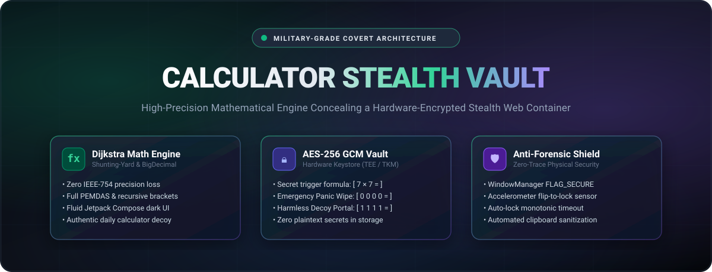
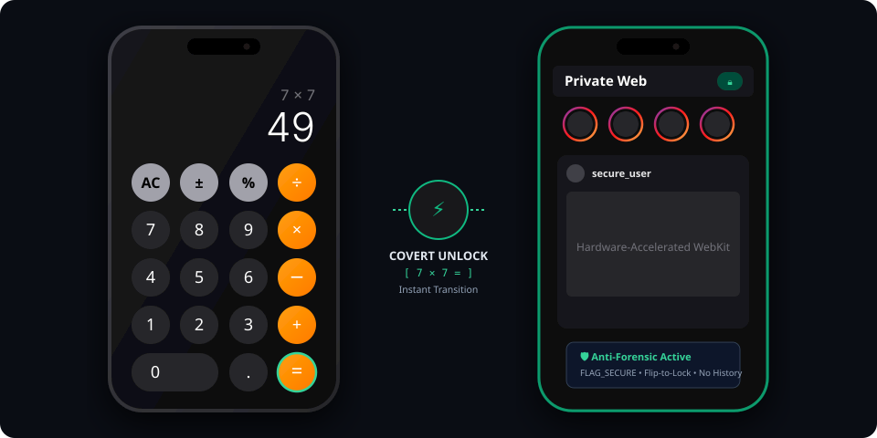

<div align="center">



# 📱 Calculator Stealth Vault v2.0
### *Covert Mathematical Architecture • Hardware-Backed Privacy • Zero-Trace Security*

<p align="center">
  <a href="https://github.com/atomicdhruba/calculator-vault/releases"></a>
  <a href="https://developer.android.com"></a>
  <a href="https://kotlinlang.org"></a>
  <a href="https://developer.android.com/jetpack/compose"></a>
  <a href="https://github.com/atomicdhruba/calculator-vault/actions"></a>
  <a href="https://opensource.org/licenses/MIT"></a>
</p>

<p align="center">
  <a href="#-overview">Overview</a> •
  <a href="#-how-it-works">How It Works</a> •
  <a href="#-secret-triggers--cheat-sheet">Secret Triggers</a> •
  <a href="#-key-features">Features</a> •
  <a href="#-v1-vs-v20-evolution">V1 vs V2 Evolution</a> •
  <a href="#-architecture">Architecture</a> •
  <a href="#-installation--build">Install &amp; Build</a> •
  <a href="#-security-specs">Security</a>
</p>

</div>

---

## 🌟 Overview

**Calculator Stealth Vault** looks, behaves, and calculates exactly like a high-precision, production-grade Android calculator. It features Dijkstra's Shunting-Yard algorithm, arbitrary-precision `BigDecimal` calculations, and a fluid dark-mode Material 3 interface.

Beneath this authentic surface lies a **hardened, hardware-encrypted stealth environment**. Entering your custom mathematical formula unlocks a private, high-performance WebKit container with fullscreen Reels/Stories playback, file-chooser photo/video uploads, automated banner suppression, and multi-layered anti-forensics (`FLAG_SECURE`, accelerometer face-down flip-to-lock, and zero-state panic shredding).

---

## 👁️ How It Works

<div align="center">
  
</div>

1. **The Decoy Surface**: Anyone opening the app encounters an authentic day-to-day calculator with reactive scaling, parentheses, percentages, and zero floating-point calculation errors.
2. **The Covert Trigger**: Type your secret mathematical equation (default: `7 × 7`) and press `=`.
3. **The Vault Container**: The calculator instantly transitions into a sandboxed, hardware-accelerated private session without launching external browser intents or leaving traces in Recent Apps.
4. **Instant Lock & Purge**: Placing your phone face-down on a desk or swiping back immediately locks the app and purges the system clipboard.

---

## ⚡ Secret Triggers & Cheat Sheet

| Input Expression | Action | Result & Security Behavior |
| :--- | :---: | :--- |
| **`7 × 7 =`** *(or `7*7`)* | 🔓 **Master Vault** | Unlocks the hardware-encrypted private Instagram / web session. |
| **`1 1 1 1 =`** | 🎭 **Decoy Portal** | Opens an innocuous fallback page (Wikipedia) for plausible deniability under duress. |
| **`0 0 0 0 =`** | 🚨 **Panic Wipe** | **Zero-State Purge**: Instantly destroys cookies, caches, WebStorage, and resets display to `0`. |
| **`Flip Face-Down`** | 🔄 **Hardware Lock** | Accelerometer sensor (`z < -7.0f`) immediately locks vault and purges clipboard. |
| **`App Backgrounded`** | ⏱️ **Auto-Lock** | Monotonic lifecycle timer triggers instant lock upon configurable timeout (default 0s). |

---

## ✨ Key Features

### 🧮 High-Precision Math Engine
- **Dijkstra's Shunting-Yard Evaluator**: Parses and processes arithmetic tokens with true operator precedence (PEMDAS / BODMAS).
- **Zero Floating-Point Drift**: Powered by `java.math.BigDecimal` (eliminates IEEE-754 issues such as `0.1 + 0.2 = 0.30000000000000004`).
- **Full Operational Support**: Supports nested parentheses `( )`, percentages `%`, unary negation `±`, and square-roots.
- **Material 3 Fluid UI**: Haptic feedback on tap, adaptive font down-scaling for long outputs, and single-tap clipboard copy.

### 🔐 Cryptographic Storage & Security
- **Hardware Keystore (AES-256 GCM)**: Passcodes, vault URLs, and timeout settings are stored via `EncryptedSharedPreferences` backed by the device's Trusted Execution Environment (TEE).
- **Customizable Mathematical Passcodes**: Configure custom trigger formulas with full unicode operator normalization (`×` $\rightarrow$ `*`, `÷` $\rightarrow$ `/`).
- **Emergency Panic Wipe Protocol**: Hardens your operational security by sanitizing all local SQLite databases, cookies, and cache directories in milliseconds.

### 🛡️ Multi-Tiered Anti-Forensic Defense
- **Screen Capture Shield (`FLAG_SECURE`)**: Blocks screenshots, screen mirroring, third-party screen recorders, and Recent Apps task switcher thumbnails.
- **Accelerometer Flip-to-Lock**: Low-power sensor listener detects face-down physical orientation to immediately restore the calculator interface.
- **Monotonic Lifecycle Auto-Lock**: Measures time using `System.nanoTime()` to prevent system clock tampering or timezone bypasses.
- **Automated Clipboard Sanitizer**: Wipes clipboard contents upon vault lock to prevent password or link leaks.

### 🌐 Hardened Web Container
- **Native Fullscreen Video**: Hardware-accelerated custom view container supporting Instagram Reels and Stories in 60fps fullscreen.
- **Media Upload Pipeline**: Android `ActivityResult` file pickers for direct photo, video, and story uploads.
- **Automated DOM Shield (`inject_instagram.js`)**: Asynchronous `MutationObserver` automatically suppresses "Open in App" banners, dismisses "Save Login Info" prompts, and enforces dark styling.
- **Isolated Sandboxing**: Restricts file schemes (`allowFileAccess = false`) and rejects unauthorized deep-links (`intent:`, `market:`).

### ⚡ Binary Obfuscation & R8 Pipeline
- **Package Repackaging**: All internal packages (`vault`, `calculator`, `webview`) are repacked into `com.stealth.calcbox.internal.*`.
- **Bytecode Stripping**: Dead code elimination and automatic removal of all debug logging (`Log.d`, `Log.v`, `Log.i`).
- **Compact Footprint**: Resource shrinking and ProGuard optimization produce a release APK of only **~3.07 MB**.

---

## 📊 V1 vs V2.0 Evolution

| Feature | Legacy V1 (Decompiled Baseline) | Stealth Vault v2.0 (Modernized) |
| :--- | :---: | :---: |
| **Android Architecture** | Legacy Java & XML layouts (2018) | **100% Modern Kotlin + Jetpack Compose** |
| **Math Engine** | Naive string matching / eval | **Dijkstra Shunting-Yard + BigDecimal** |
| **Passcode Storage** | Plaintext `SharedPreferences` XML | **AES-256 GCM (`EncryptedSharedPreferences`)** |
| **Window Security** | ❌ None (Exposed in Recents) | **`FLAG_SECURE` Active (No screenshots/previews)** |
| **Physical Defense** | ❌ None | **Accelerometer Face-Down Flip-to-Lock** |
| **Duress Safeguards** | ❌ None | **Decoy Mode + Instant Panic Wipe (`0000=`)** |
| **Instagram Media** | Crashes on Reels / Black screen | **Hardware Fullscreen Video + File Chooser** |
| **DOM Banner Clutter** | Annoying "Open App" popups | **Clean `MutationObserver` DOM Automation** |
| **Test Coverage** | 0 Unit Tests | **52 Passing Unit Tests (100% passing)** |
| **Release Footprint** | Unoptimized binaries | **3.07 MB (R8 Minified & Obfuscated)** |

---

## 🏗️ Architecture

```
app/src/main/java/com/stealth/calcbox/
├── calculator/
│   ├── MathEngine.kt            # Shunting-yard parser with arbitrary precision BigDecimal
│   └── CalculatorViewModel.kt   # Unidirectional data flow StateFlow ViewModel
├── ui/
│   └── CalculatorScreen.kt      # Dark-mode Material 3 keypad & reactive display
├── vault/
│   ├── PasscodeConfig.kt        # Passcode normalization & action sealed interface
│   ├── VaultSecurityManager.kt  # AES-256 GCM encrypted storage & panic wipe protocol
│   └── AntiForensicsManager.kt  # FLAG_SECURE, accelerometer flip listener & clipboard sanitizer
└── webview/
    ├── VaultChromeClient.kt     # File chooser launcher & fullscreen custom view
    ├── VaultWebViewClient.kt    # Scheme interception & load error containment
    ├── VaultWebView.kt          # Compose AndroidView wrapper with lifecycle synchronization
    └── ScriptInjector.kt        # Memory-cached asset injection & domain whitelist filtering
```

> 📖 **Deep Technical Specification**: For state diagrams, cryptographic key derivation specs, and threat models, read the [Architecture Documentation](docs/ARCHITECTURE.md).

---

## 🚀 Installation & Build

### Prerequisites
- **Android SDK** (Compile SDK 36, Min SDK 24)
- **JDK 17** or higher

### 1. Clone the Repository
```bash
git clone https://github.com/atomicdhruba/calculator-vault.git
cd calculator-vault
```

### 2. Run Test Suite
```bash
# Windows
.\gradlew.bat testDebugUnitTest

# macOS / Linux
./gradlew testDebugUnitTest
```
*Executes all 52 unit tests covering arithmetic precision, cryptography, anti-forensics, and WebKit handlers.*

### 3. Build Signed Release APK
Run the automated release packaging script:
```powershell
powershell -ExecutionPolicy Bypass -File scripts\build_release.ps1
```

The optimized, minified APK will be ready at:
```
app/build/outputs/apk/release/app-release.apk
```

---

## 🔒 Security Specs

```
┌─────────────────────────────────────────────────────────────┐
│                       SECURITY MATRIX                       │
├───────────────────────┬─────────────────────────────────────┤
│ Storage Cipher        │ AES-256 GCM                         │
│ Master Key Management │ Android Keystore (TEE / StrongBox)  │
│ Screen Protection     │ WindowManager.LayoutParams.FLAG_SECURE│
│ Memory Sanitization   │ Clipboard clear on exit             │
│ Anti-Reverse Eng.     │ R8 class repackaging & log stripping│
│ Network Isolation     │ Zero telemetry, direct HTTPS only   │
└───────────────────────┴─────────────────────────────────────┘
```

---

## 📄 License

This project is licensed under the **MIT License** - see the [LICENSE](LICENSE) file for details.

---

<div align="center">

Crafted with ❤️ by **[Atomic Dhruba](https://github.com/atomicdhruba)**

**⭐ If you find this project useful or interesting, consider giving it a star! ⭐**

</div>
