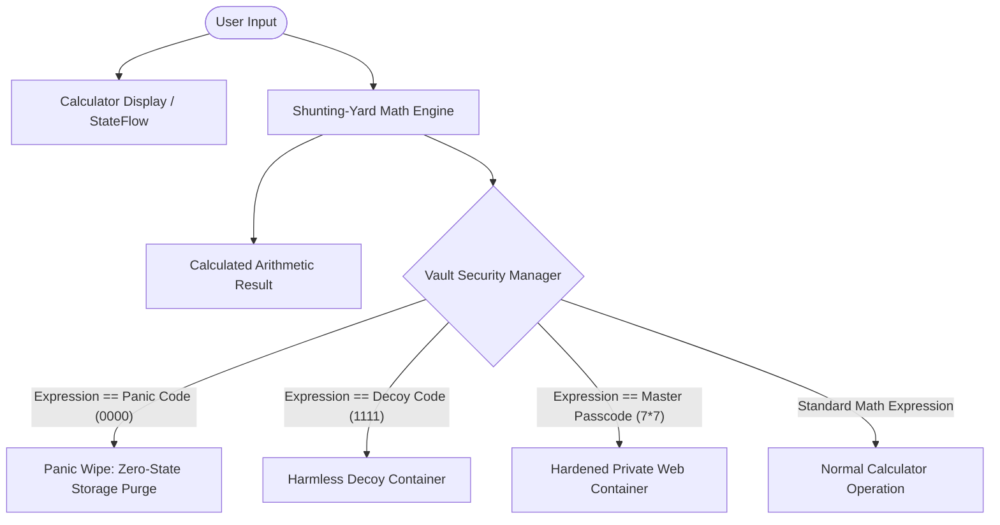
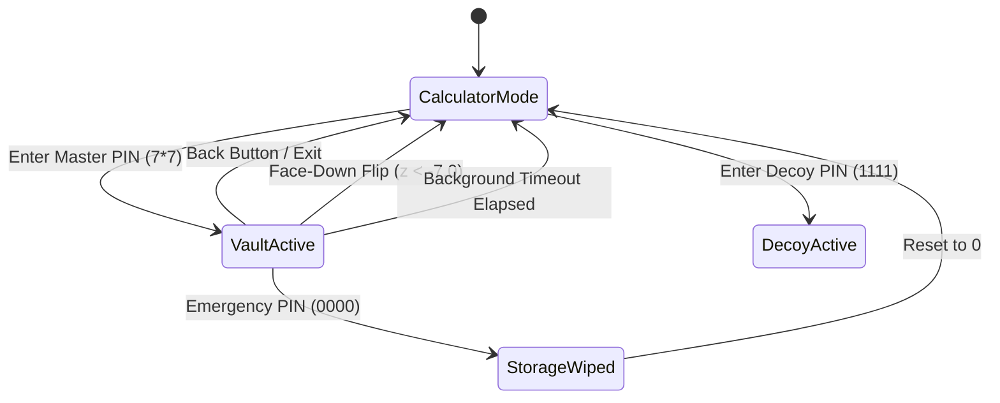

# System Architecture & Security Specification

This document details the software architecture, cryptographic safeguards, and anti-forensic security model implemented in **Calculator Stealth Vault v2.0**.

---

## 1. System Overview

Calculator Stealth Vault functions as an authentic, high-precision dark-mode calculator for ordinary day-to-day calculations. Behind the calculation engine lies a hardware-encrypted covert privacy vault that unlocks dedicated browsing sessions, decoy routes, or panic wipe procedures based on mathematical expression evaluation.



---

## 2. Core Architecture Components

The application follows Android MVVM architecture with reactive StateFlow and clean separation of concerns:

```
com.atomicdhruba.calculator
├── calculator/             # Mathematical evaluation & UI state management
│   ├── MathEngine.kt       # Dijkstra Shunting-Yard parser & BigDecimal evaluator
│   └── CalculatorViewModel # Reactive input buffer, history, and evaluation dispatcher
├── ui/                     # Jetpack Compose UI presentation layer
│   └── CalculatorScreen.kt # Authentic Apple/Material 3 dark calculator interface
├── vault/                  # Cryptographic storage & anti-forensics
│   ├── PasscodeConfig.kt   # Passcode normalization & action definitions
│   ├── VaultSecurityManager# Hardware-backed EncryptedSharedPreferences & panic engine
│   └── AntiForensicsManager# Window FLAG_SECURE, sensor listener, and clipboard purger
└── webview/                # Production web container & DOM automation
    ├── VaultChromeClient   # File chooser launcher, fullscreen video, progress
    ├── VaultWebViewClient  # Scheme interception, error isolation, DOM injection
    ├── VaultWebView        # Compose AndroidView wrapper with BackHandler & lifecycle
    └── ScriptInjector      # In-memory script caching and domain-restricted evaluator
```

---

## 3. Cryptographic Storage & Security Model

### 3.1 Hardware-Backed Key Derivation
- All vault settings (custom master passcode, decoy passcode, panic wipe trigger, target URLs, and auto-lock timeout) are encrypted using **`EncryptedSharedPreferences`**.
- Encryption keys are backed by **Android Keystore** using **AES-256 GCM** encryption with `MasterKey.DEFAULT_AES256_GCM_SPEC`.
- Key material is non-exportable and bound to device hardware (TEE / StrongBox).

### 3.2 Evaluation Precedence & Normalization
Expressions entered by the user are normalized before cryptographic comparison:
1. Unicode mathematical symbols (`×`, `✕`, `÷`, `−`, `–`, `—`) are mapped to canonical ASCII operators (`*`, `/`, `-`).
2. All whitespace is removed.
3. Trailing `=` signs are trimmed.
4. Expressions are checked in strict security order:
   $$\text{Panic Wipe} \longrightarrow \text{Decoy Mode} \longrightarrow \text{Vault Mode} \longrightarrow \text{Neutral Display}$$

---

## 4. Multi-Layered Anti-Forensics



1. **Window Protection (`FLAG_SECURE`)**:
   - Attached to the window in `MainActivity.onCreate()` before view composition.
   - Blocks OS-level screenshots, screen recorders, and Recent Apps task switcher thumbnails.

2. **Accelerometer Face-Down Sensor**:
   - `FlipToLockSensorListener` monitors `Sensor.TYPE_ACCELEROMETER`.
   - When negative Z acceleration crosses `z < -7.0f`, the device is face-down on a surface, triggering instant vault lock and clipboard purge.
   - Dual threshold with `z > -2.0f` prevents fluttering or erratic re-triggers.

3. **Monotonic Lifecycle Auto-Lock**:
   - Background tracking uses `System.nanoTime()` rather than wall-clock time (`System.currentTimeMillis()`), rendering grace period calculations immune to NTP adjustments or clock manipulation.
   - Configurable timeout (default 0s instant lock on backgrounding, or customizable multitask windows).

4. **Emergency Panic Wipe Protocol**:
   - Instantly wipes app SharedPreferences (`preferences.edit().clear().commit()`) from disk.
   - Flushes and wipes `CookieManager` session tokens.
   - Clears `WebStorage` and deletes WebView database files and caches.
   - Purges the system clipboard and resets the calculator screen to `"0"`.

---

## 5. WebKit Engine Hardening

- **File Access Restrictions**: `allowFileAccess = false` prevents local file system exfiltration via `file://` URIs.
- **Strict Mixed Content**: `mixedContentMode = WebSettings.MIXED_CONTENT_NEVER_ALLOW` enforces end-to-end TLS encryption.
- **Deep Link & Scheme Isolation**: Non-HTTP schemes (`intent:`, `market:`, `instagram:`, `tel:`, `mailto:`, `javascript:`) are safely intercepted and consumed, preventing crashes and external application chooser leaks.
- **Media Pipeline**: Native `WebChromeClient.onShowFileChooser` connected to Jetpack Activity Result launchers for seamless photo/video uploads, and `onShowCustomView` for hardware-accelerated full-screen video playback.

---

## 6. Binary Obfuscation (R8)

- **Class Flattening**: Internal classes across `calculator`, `vault`, and `webview` are repackaged into a single flat obfuscated package (`com.atomicdhruba.calculator.internal.*`).
- **Access Modification**: `-allowaccessmodification` aggressively inlines and tightens access scopes.
- **Log Stripping**: Android debug logging (`Log.v`, `Log.d`, `Log.i`) is removed via `-assumenosideeffects`.
- **Source Concealment**: `-renamesourcefileattribute SourceFile` conceals internal source paths.
